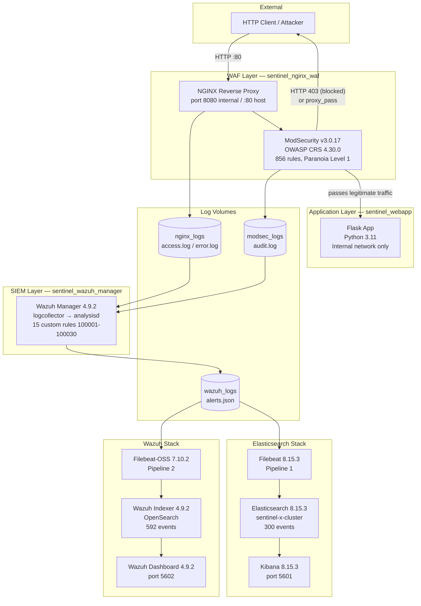

# SENTINEL-X — Architecture Deep Dive

Detailed explanation of every component in the stack.

---

## Architecture Diagram (Mermaid)



---

## 1. Docker and Docker Compose

**What Docker is:**  
Docker is a platform for running applications in isolated environments called containers. Instead of installing software on your Windows machine directly (with all the dependency conflicts that causes), Docker packages each application with its own operating system layer, libraries, and dependencies into a single image.

**What containers are:**  
A container is a running instance of an image. It is isolated from other containers and from the host operating system. Each container gets its own network interface, filesystem, and process space. When you run `docker ps`, you see your running containers.

**What images are:**  
An image is the blueprint. `wazuh/wazuh-manager:4.9.2` is an image. When Docker starts a container from it, it creates an isolated environment with Wazuh already installed and configured. The image itself never changes — only containers change while running.

**What Docker networks do:**  
Docker creates virtual networks that containers can join. Containers on the same network can reach each other by name (e.g., `webapp` resolves to the Flask container's IP). Networks with `internal: true` have no connection to the host or internet — this isolates the Flask app from outside access.

SENTINEL-X has 6 networks:
- `sentinel_frontend` — External bridge, connects host to nginx-waf on port 80
- `sentinel_application` — Internal only, nginx-waf ↔ webapp
- `sentinel_analytics` — Internal, wazuh-manager ↔ filebeat ↔ elasticsearch ↔ kibana
- `sentinel_wazuh_stack` — Internal, wazuh components
- `sentinel_management` — External bridge, host ↔ ES/Kibana/Wazuh Dashboard (admin ports)
- `sentinel_monitoring` — Internal, wazuh-manager (log volume access)

**What volumes do:**  
Volumes are persistent storage that survives container restarts. When a container writes to a volume path, the data persists even if the container is stopped or deleted. SENTINEL-X uses 16 named volumes. The most important: `elasticsearch_data`, `wazuh_indexer_data` (your alert databases), `wazuh_logs` (the shared log file both Filebeats read), `nginx_logs`, `modsec_logs`.

**How Docker Compose works:**  
`docker-compose.yml` defines the entire system in one file. Running `docker compose up -d` reads this file and starts all 9 containers in dependency order: healthchecks ensure elasticsearch is green before kibana starts, wazuh-indexer is healthy before wazuh-dashboard starts.

---

## 2. NGINX — The Reverse Proxy

**What a reverse proxy is:**  
A regular proxy sits between a client and the internet (like a VPN). A *reverse* proxy sits between the internet and your servers. Clients connect to the reverse proxy, not to your application directly. This means:
- The application never sees external traffic directly
- The proxy can inspect, modify, or block requests before they reach the app
- The app's real address (webapp:8080) is hidden from clients

**How NGINX works in SENTINEL-X:**  
Every HTTP request to port 80 on your machine hits the `sentinel_nginx_waf` container. NGINX receives the request on internal port 8080. Before forwarding:
1. ModSecurity inspects the request (see section 3)
2. If blocked: NGINX returns HTTP 403, writes an audit log
3. If allowed: `proxy_pass http://webapp:8080` forwards to Flask

The Flask app (`sentinel_webapp`) has NO host port mapping in docker-compose.yml. It only listens on internal Docker network port 8080. The only way to reach it from outside is through NGINX.

**Security headers added by NGINX:**  
NGINX adds these headers to every response:
- `X-Content-Type-Options: nosniff` — prevents MIME type sniffing attacks
- `X-Frame-Options: SAMEORIGIN` — prevents clickjacking in iframes
- `X-XSS-Protection: 1; mode=block` — legacy browser XSS protection
- `Content-Security-Policy` — restricts what sources can load scripts, styles
- `Referrer-Policy` — limits Referer header leakage

**Logs NGINX generates:**  
- `access.log` — JSON format, every HTTP request (hit or block)
- `error.log` — NGINX errors, startup issues

Both are written to the `nginx_logs` Docker volume and read by Wazuh Manager.

---

## 3. ModSecurity and OWASP CRS — The WAF Engine

**What a Web Application Firewall (WAF) is:**  
A WAF inspects HTTP traffic at Layer 7 (application layer). Unlike a network firewall that only sees IP/port, a WAF reads the full HTTP request: URL, query parameters, POST body, headers, cookies. It can detect attack patterns hidden in those fields.

**How ModSecurity inspects HTTP requests:**  
ModSecurity is a WAF engine that runs as an NGINX module. For every incoming request:

1. **Phase 1 (Request headers):** Inspect headers, method, URI
2. **Phase 2 (Request body):** Inspect POST/PUT body content
3. **Phase 3 (Response headers):** Inspect outgoing headers
4. **Phase 4 (Response body):** Inspect outgoing body content
5. **Phase 5 (Logging):** Write audit log entry

The OWASP CRS rules run in phases 1 and 2.

**What OWASP CRS is:**  
The OWASP Core Rule Set (CRS) is a set of 856 ModSecurity rules maintained by OWASP. Each rule detects a specific attack pattern. They are organized into families:
- `920xxx` — Protocol anomalies
- `930xxx` — LFI / path traversal  
- `932xxx` — OS command injection / RCE patterns
- `941xxx` — XSS
- `942xxx` — SQL injection
- `949110` — The final anomaly scoring gate

**How anomaly scoring works:**  
Instead of blocking on any single rule match, CRS v4 uses scoring. Each matching rule adds to a score:
- Critical match: +5 points
- Error match: +4 points
- Warning match: +3 points
- Notice match: +2 points

Rule `949110` runs at the end of phase 2. It checks the total score. If the total is ≥ 5 (our `ANOMALY_INBOUND` setting), it blocks the request with HTTP 403. This reduces false positives — a single weak match won't trigger a block.

**How SQL injection detection works:**  
Rule `942100` uses a library called **libinjection**. libinjection tokenizes the string and fingerprints it against known SQL syntax patterns. For `1 OR 1=1--`, libinjection identifies `OR`, `=`, and `--` as SQL operators and flags it. This is more accurate than simple string matching.

**How XSS detection works:**  
Rules in `941xxx` family scan for HTML tag patterns (`<script>`, ``, event handlers like `onerror=`). libinjection's HTML tokenizer is also used. The `<script>alert(1)</script>` pattern triggers multiple 941xxx rules.

**How path traversal detection works:**  
Rules `930100`/`930110` detect `../`, `..\`, `%2F..%2F`, `%252F` (double-encoded) in URL paths and query strings. CRS decodes percent-encoding before matching.

**What HTTP 403 means:**  
"Forbidden" — the server understood the request but refused to execute it. ModSecurity returns 403 when the anomaly score exceeds the threshold. The client (attacker) knows they were blocked but not why or how.

**How audit logs are generated:**  
When `SecAuditEngine RelevantOnly` is set, ModSecurity writes a JSON audit record for every blocked or suspicious request. The audit log includes:
- Full request (URI, headers, body)
- Full response (HTTP code, headers)
- Every rule that matched with matched data
- Total anomaly score
- Component versions (OWASP_CRS/4.30.0)

The audit log path: `/var/log/modsecurity/audit.log` inside the container → `modsec_logs` Docker volume → readable by Wazuh Manager.

---

## 4. Flask Web Application

**Role in the architecture:**  
The Flask app is the protected asset. In a real deployment this would be your actual business application. Here it is a deliberately simple test app with endpoints designed to trigger WAF detections.

**How NGINX communicates with it:**  
Via `proxy_pass http://webapp:8080`. Docker DNS resolves `webapp` to the Flask container's IP on the `application_net` network. NGINX adds `X-Real-IP`, `X-Forwarded-For`, and `X-Forwarded-Proto` headers so Flask knows the original client IP.

**What happens when a request is blocked:**  
ModSecurity blocks BEFORE `proxy_pass` executes. The request never arrives at Flask. The Flask application receives only requests that passed WAF inspection. It has no knowledge that blocked requests existed.

**The app endpoints and what they test:**  
- `/search?q=` → SQLi and XSS detection (query parameter)
- `/?file=` → LFI/path traversal detection
- `/?cmd=` → RCE pattern detection
- `/api/users?id=` → SQLi via numeric parameter
- `/contact` (POST) → Request body inspection
- `/admin` → Returns 403 (scanner detection)

---

## 5. Wazuh SIEM — The Detection Engine

**What a SIEM is:**  
Security Information and Event Management. A SIEM collects logs from many sources, normalizes them, applies detection rules, and generates structured alerts. It is the central nervous system of a SOC.

**Wazuh architecture:**  
Wazuh Manager consists of several daemons (background processes):
- `logcollector` — Monitors log files and reads new events
- `analysisd` — The rule engine — applies decoders and rules to each event
- `remoted` — Handles Wazuh agent connections (not used here)
- `wazuh-db` — Stores state information
- `wazuh-modules` — Extended capabilities

**How Wazuh receives logs in SENTINEL-X:**  
Instead of using agents, Wazuh reads log files from shared Docker volumes. In `ossec.conf`:
```xml
<localfile>
  <log_format>json</log_format>
  <location>/var/log/nginx/access.log</location>
</localfile>
<localfile>
  <log_format>json</log_format>
  <location>/var/log/modsecurity/audit.log</location>
</localfile>
```
The `logcollector` daemon uses inotify to detect new log lines and passes them to `analysisd`.

**What decoders do:**  
A decoder tells Wazuh how to parse a raw log line into named fields. The JSON decoder (`0006-json_decoders.xml`) handles both NGINX and ModSecurity logs because both write JSON. Custom decoders in `modsecurity_decoders.xml` and `nginx_decoders.xml` extract `srcip`, request URI, and other fields using regex.

**How detection rules work:**  
Rules are XML files. Each rule has:
- `id` — unique number
- `level` — severity 0–15 (0=silent, 15=maximum)
- `if_sid` — parent rule (this rule only fires if parent matched)
- `match` — raw text search in the log line
- `description` — human-readable alert description
- `group` — classification tags
- `mitre` — ATT&CK technique IDs

**Key insight about rule matching in Wazuh 4.9:**  
Wazuh 4.9.2 passes JSON log events as decoded flat strings to `analysisd`. The `<field>` tag in rules does NOT match data.* fields from JSON logs. Only `<match>` against the raw log text works. This is why all SENTINEL-X rules use `<match>` with text patterns from the JSON.

**How an event becomes an alert:**
1. logcollector reads new line from log file
2. JSON decoder identifies the log source
3. analysisd runs the event through base rules first (100001 for NGINX, 100010 for ModSec)
4. If base rule matches, child rules are evaluated
5. First child rule that matches wins
6. If rule level ≥ configured threshold (default: 1), an alert is written to `alerts.json`
7. The alert includes the original log data plus rule metadata

**MITRE ATT&CK mapping:**  
Every SENTINEL-X rule is mapped to ATT&CK techniques. The main one is T1190 (Exploit Public-Facing Application). Rule 100020 also maps T1059.007 (JavaScript). Rule 100022 maps T1083 (File and Directory Discovery). These IDs appear in the alert and populate the MITRE ATT&CK dashboard in Wazuh Dashboard.

---

## 6. Wazuh Indexer — The Wazuh-Native Database

**What it is:**  
Wazuh Indexer is a customized distribution of OpenSearch (which is itself based on Elasticsearch 7.10). It is the official alert storage backend for Wazuh 4.x.

**Why Wazuh uses it:**  
The Wazuh Dashboard (the SOC UI) has a Wazuh plugin that connects to Wazuh Indexer directly. It cannot connect to commercial Elasticsearch. The Wazuh team built their own indexer to avoid the Elastic license change in 2021. Wazuh Indexer and Elasticsearch share the same REST API (compatible at HTTP level) but differ in features and licensing.

**Where the data lives:**  
In the `wazuh_indexer_data` Docker volume, in indices named `wazuh-alerts-4.x-{date}`. As of project completion: 592 events across two indices.

**How the Wazuh Dashboard queries it:**  
The dashboard connects to `https://wazuh-indexer:9200` on the internal `wazuh_stack_net` network. All communication uses TLS with the certificates in `certs/`. The dashboard reads saved objects (dashboards, visualizations) from the `.kibana_1` index stored in Wazuh Indexer.

---

## 7. Filebeat — The Log Shipper

**What Filebeat does:**  
Filebeat is a lightweight agent that monitors files and ships new lines to a destination (Elasticsearch, Logstash, OpenSearch). It is part of the Elastic Stack.

**Pipeline 1 — `sentinel_filebeat` (v8.15.3 → Elasticsearch):**  
- Reads: `/var/ossec/logs/alerts/alerts.json`
- Adds ECS metadata: `@timestamp`, `agent.name`, `agent.version`, `ecs.version: 8.0.0`
- Adds tags: `["wazuh-alert", "sentinel-x"]`
- Outputs to: `http://elasticsearch:9200`
- Uses basic auth (username/password from environment)
- Registry (last-read position) stored in `filebeat_data` volume

**Pipeline 2 — `sentinel_filebeat_wazuh` (v7.10.2 → Wazuh Indexer):**  
- Reads: same `alerts.json` file
- Uses the official Wazuh Filebeat module (applies Wazuh's index template)
- Outputs to: `https://wazuh-indexer:9200`
- Uses TLS with client certificates from `certs/` directory
- Registry stored in `filebeat_wazuh_data` volume (independent from pipeline 1)

**Why two Filebeats can read the same file without conflict:**  
Each Filebeat maintains its own registry file (a database of which files it has read and how far). They work independently. Reading the same file twice is not a problem — both simply read every line.

**The restart policy issue:**  
Both Filebeat containers use `restart: unless-stopped`. Filebeat has a `close_inactive` setting — if no new log lines arrive for a period, Filebeat closes the file handle and can exit cleanly (exit code 0). Docker does NOT restart containers that exit cleanly with `unless-stopped`. This caused `sentinel_filebeat_wazuh` to silently stop for 15 hours during development. The fix is to change to `restart: always` or add a healthcheck.

**Troubleshooting a stopped Filebeat:**
```powershell
docker start sentinel_filebeat_wazuh
docker logs sentinel_filebeat_wazuh --tail 20
```
No data is lost — the registry tracks the last position and Filebeat resumes from there.

---

## 8. Elasticsearch — Analytics Storage

**What Elasticsearch is:**  
Elasticsearch is a distributed search and analytics engine. It stores documents as JSON in indices. Documents are searchable in near-real-time using a powerful query language (DSL). It is the "E" in ELK Stack.

**How it differs from OpenSearch:**  
OpenSearch is the AWS-maintained fork, created after Elastic changed from Apache 2.0 to SSPL license in January 2021. As of version 7.10 (the last shared codebase version), both have the same REST API. After that they diverged in features, ML capabilities, and licensing. Wazuh Indexer is OpenSearch-based. Standard Kibana is Elasticsearch-based.

**How SENTINEL-X uses Elasticsearch:**  
Filebeat (Pipeline 1) sends every Wazuh alert as a JSON document to the `.ds-wazuh-alerts-{date}` data stream. Documents contain the full alert: rule metadata, original log data, CRS evidence, timing, source IP.

**Data streams vs. indices:**  
A data stream is a managed abstraction over time-based indices. When you write to `wazuh-alerts-*`, Elasticsearch internally creates `.ds-wazuh-alerts-2026.11.12-000001`, `.ds-wazuh-alerts-2026.11.13-000001`, etc. This makes time-range queries efficient and simplifies lifecycle management.

**How to query security events directly:**
```powershell
# Count all SQLi events
curl -s -u elastic:changeme_elastic_lab -X POST "http://localhost:9200/.ds-wazuh-alerts-*/_search" -H "Content-Type: application/json" -d "{\"query\":{\"term\":{\"rule.id\":\"100020\"}},\"_source\":[\"@timestamp\",\"rule.description\",\"data.transaction.client_ip\"]}"
```

---

## 9. Kibana — Visualization

**What Kibana is:**  
Kibana is the visualization front-end for Elasticsearch. It provides:
- **Discover** — search and browse individual events
- **Dashboards** — visualization panels with charts and tables
- **Dev Tools** — Elasticsearch query console
- **Alerting** — trigger notifications when events match criteria

**Data Views:**  
A Data View (formerly called Index Pattern) tells Kibana which Elasticsearch index to query and which field is the timestamp. The SENTINEL-X Data View is already configured:
- Name: "SENTINEL-X Wazuh Alerts"
- Pattern: `wazuh-alerts-*`
- Time field: `@timestamp`

**How to investigate alerts in Kibana Discover:**  
1. Open `http://localhost:5601`
2. Click Discover
3. Select "SENTINEL-X Wazuh Alerts" from the Data View dropdown
4. Set time range: Last 24 hours
5. Use KQL (Kibana Query Language): `rule.id: 100020` to find SQLi events
6. Click an event to expand it
7. See all fields: `rule.description`, `data.transaction.request.uri`, `rule.mitre.id`

---

## Why Both Wazuh Indexer AND Elasticsearch?

This is the most important question about the architecture:

| Aspect | Wazuh Indexer | Elasticsearch |
|---|---|---|
| Based on | OpenSearch (ES fork, v7.10) | Elasticsearch 8.15.3 (commercial) |
| Required by | Wazuh Dashboard (can ONLY read Wazuh Indexer) | Assignment requirement |
| Event count | 592 events | 300 events |
| Dashboard | Wazuh Dashboard at :5602 | Kibana at :5601 |
| Analytics features | OpenSearch ML, Wazuh plugin | Full Elastic Stack, ECS v8 |
| TLS | Yes — mutual TLS required | No — HTTP only in this lab |

**The Wazuh Dashboard is NOT optional if you want the Wazuh SOC UI** — it requires the Wazuh Indexer. You cannot point it at Elasticsearch. So the choice is: skip the Wazuh Dashboard, or deploy both storage backends. We deployed both because:
1. The Wazuh Dashboard provides better SOC workflows
2. Elasticsearch is required by the assignment
3. Having both demonstrates a real enterprise pattern (segregated storage for different consumers)
