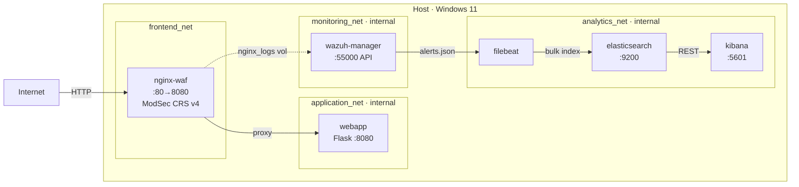
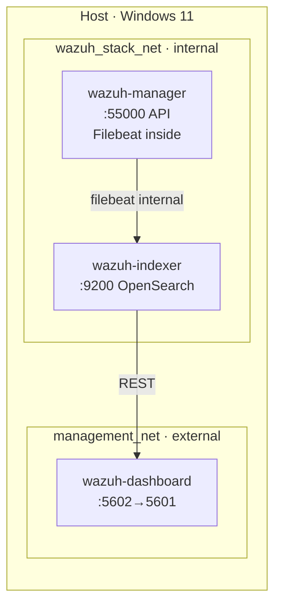

# SENTINEL-X — System Architecture

## Overview

SENTINEL-X is a containerised, enterprise-style web security monitoring platform running on Docker.
It provides a WAF-to-SIEM-to-SOAR pipeline covering detection, alerting, and analytics.

## Component responsibilities

| Container | Image | Role |
|---|---|---|
| `sentinel_nginx_waf` | `owasp/modsecurity-crs:nginx-alpine` | Reverse proxy + WAF. Receives all HTTP traffic, applies OWASP CRS v4 rules, blocks or passes requests. |
| `sentinel_webapp` | `sentinel-x-webapp` (python:3.12-alpine) | Protected Flask test application. Reachable only via nginx-waf. |
| `sentinel_wazuh_manager` | `wazuh/wazuh-manager:4.9.2` | SIEM engine. Reads nginx and ModSecurity logs via shared volumes, generates structured alerts. |
| `sentinel_filebeat` | `filebeat:8.15.3` | Log shipper. Reads Wazuh alerts.json and indexes into Elasticsearch. |
| `sentinel_elasticsearch` | `elasticsearch:8.15.3` | Search and analytics store. Single-node cluster, security enabled, no TLS (lab). |
| `sentinel_kibana` | `kibana:8.15.3` | Analyst dashboard. Data view: `wazuh-alerts-*`, 6718 mapped fields. |

## Network segmentation

Five Docker bridge networks provide isolation:

```
sentinel_frontend    172.20.0.0/24  external   nginx-waf only (host-exposed)
sentinel_application 172.20.1.0/24  internal   nginx-waf ↔ webapp
sentinel_monitoring  172.20.2.0/24  internal   wazuh-manager
sentinel_analytics   172.20.3.0/24  internal   wazuh → filebeat → elasticsearch → kibana
sentinel_management  172.20.4.0/24  external   elasticsearch:9200, kibana:5601 → host
```

Containers on `internal: true` networks have no direct internet access.
The `management_net` exists because Docker Desktop on Windows does not publish ports
for containers attached only to internal networks.

## Event flow

```
Internet HTTP → nginx-waf(:80)
    │  ModSecurity evaluates request against 856 CRS rules
    │  BLOCK: returns HTTP 403 (rule 949110, anomaly score)
    │  PASS:  proxies to webapp(:8080)
    │
    ├─ /var/log/nginx/access.log  ─── [sentinel_nginx_logs volume]
    ├─ /var/log/nginx/error.log   ─── [sentinel_nginx_logs volume]
    └─ /var/log/modsecurity/audit.log  [sentinel_modsec_logs volume] ← CURRENTLY INACTIVE (see below)
         │
         └─ wazuh-manager reads logs via volume
              Logcollector → Analysisd → custom rules (100001-100030)
              Alerts written to /var/ossec/logs/alerts/alerts.json
                   │
                   └─ filebeat reads alerts.json (sentinel_wazuh_logs volume)
                        Bulk-indexes to Elasticsearch wazuh-alerts-{date}
                              │
                              └─ Kibana queries data view wazuh-alerts-*
```

## Phase 4 Status (2026-11-13) — Dual-Pipeline Fully Operational

Phase 4 added the official Wazuh Dashboard 4.9.2 with its own OpenSearch-based indexer.
All 8 containers are healthy. Two parallel SIEM pipelines run simultaneously:
- **Pipeline A** (Phase 3): WAF → Manager → Filebeat 8.x → Elasticsearch → Kibana (:5601)
- **Pipeline B** (Phase 4): WAF → Manager → Filebeat 7.x (internal) → Wazuh Indexer → Wazuh Dashboard (:5602)

## Phase 3 Status (2026-11-12) — Original Pipeline Fully Operational

### Verified pipeline (Phase 3)

```
HTTP attack → NGINX ModSecurity → HTTP 403 → modsec_audit.log (JSON)
                                              │
                                    wazuh logcollector (log_format:json)
                                              │
                                    JSON plugin decoder (0006-json_decoders.xml)
                                              │
                                    Custom rules 100001-100030
                                              │
                                    alerts.json → Filebeat → wazuh-alerts-2026.11.12
                                              │
                                    Kibana SOC dashboards
```

### Critical engineering discoveries (Phase 3 audit)

**1. `rule_dir` does not scan subdirectories**

`<rule_dir>etc/rules</rule_dir>` only loads `.xml` files from that exact directory.
Files at `etc/rules/sentinel-x/sentinel_x_rules.xml` were silently ignored until an
explicit second directive was added. This was the root cause of zero custom-rule alerts.

```xml
<!-- ossec.conf — both directives required -->
<rule_dir>etc/rules</rule_dir>
<rule_dir>etc/rules/sentinel-x</rule_dir>
```

**2. Deepest child rule always wins**

Rule 100040 (`<if_sid>100020,100021,100022,100023</if_sid>`) was appearing in every alert
instead of the specific attack type rules. It was a child of 100020-100023 (deeper in chain).
Fix: removed rule 100040 entirely. Now SQLi → 100020, XSS → 100021, LFI → 100022/100023.

**3. `<field>` conditions do not work for JSON plugin decoder events**

For events processed by the JSON plugin decoder (`log_format:json`), field-based conditions
`<field name="data.X">` do not work at rule evaluation time. Only `<match>` against the
raw JSON string works. All sentinel_x_rules.xml rules use `<match>` accordingly.

**4. LFI payload fires RCE rule (by design)**

`/?file=../../etc/passwd` matches both CRS 930xxx (LFI) and CRS 932xxx (RCE).
Both sibling rules 100022 (LFI, lvl11) and 100023 (RCE, lvl14) match.
In Wazuh, the highest-level sibling among siblings is reported: 100023 (level 14).
This is correct classification — path traversal to system files is legitimately an RCE concern.

### Outstanding issues

| Issue | Severity | Status |
|-------|---------|--------|
| srcip empty in alert descriptions | LOW | Custom decoder has error 2107; raw IP in `data.remote_addr` |
| Elasticsearch at 99.66% RAM | HIGH | Increase `mem_limit` to 4g in docker-compose.yml |
| Default credentials | CRITICAL | Lab only — rotate before shared deployment |
| No TLS between services | HIGH | Lab only — enable xpack TLS for production |

## Architecture diagram

See the interactive architecture artifact at the SENTINEL-X project gallery, or open
`scripts/sentinel-x-arch.html` for a static copy.



### Phase 4 — Wazuh Official Stack (added 2026-11-13)



**Key architecture notes (Phase 4):**
- Wazuh Indexer uses OpenSearch 2.13.0 with `compatibility.override_main_response_version: true` to report as ES 7.10.2
- Filebeat 7.10.2-oss runs **inside** the wazuh-manager container (not a separate container)
- Dashboard mounts `wazuh.yml` as `:ro` to prevent container entrypoint from appending duplicate `hosts:` blocks
- `wazuh_stack_net` is `internal: true`; dashboard is additionally on `management_net` to allow port 5602 to bind to host
